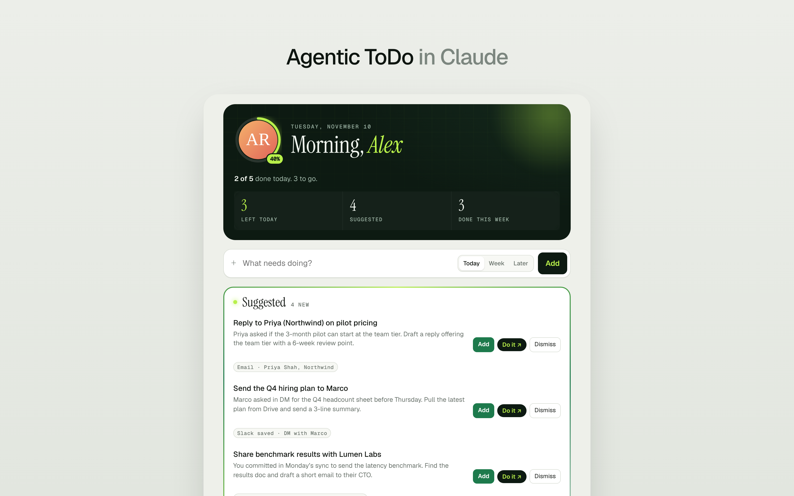

# Agentic ToDo in Claude

A private todo page published as a claude.ai artifact, backed by the artifact database so it persists across devices and redesigns, plus a scheduled task that suggests new todos from the user's tools.

What the user gets:
- **Today / This week / Later** lists with a done drawer and a progress ring for today.
- **Suggested** inbox: todos Claude found in email, Slack, meeting notes and calendar, each with its source and a short plan. Add or Dismiss. Dismissed items never come back.
- **Do it** on every task: copies a prompt with the task, source and plan, and opens a new Claude chat to paste it into. That chat prepares the work and asks before sending anything, then ticks the task off.
- Their claude.ai name and profile photo in the header (read at view time, never stored).

## Requirements

- The Artifact tool with the `db` and `user` runtime capabilities.
- A scheduling tool for recurring tasks (for the automatic suggestions).
- Optional connectors for suggestions: email (Gmail), Slack, meeting notes (e.g. Granola), calendar. Use whichever are connected; skip the rest.

## Steps

1. **Publish the page.** Copy `templates/todo-page.html` to the working directory and publish it with the Artifact tool:
   - `capabilities: {"db": {"rules": [{"path": "tasks", "read": "owner", "write": "owner"}]}, "user": {"scopes": ["profile"]}}`
   - The `owner` rule keeps the list private to the user even if they share the link.
   - `icon: "checklist"`. Retitle `<title>` to the user's name if they want (e.g. "Alex's Todos").
2. **Point the page at itself.** Replace `__ARTIFACT_URL__` in the page with the URL the publish returned and republish the same file. The Do it prompt uses it so the follow-up chat can mark the task done.
3. **Check persistence once.** With ArtifactData: `set` a probe doc in `tasks`, `list` with `as_level: "interact"` (must come back empty, proving it's private), then `delete` the probe.
4. **Create the scheduled sync.** Fill in `templates/sync-prompt.md` (artifact URL and name) and create a recurring scheduled task with it, e.g. weekdays twice a day in the user's time zone. Turn on push notifications if the user wants them.
5. **Optional first run.** Fire the task once with extra text: "This is the first run, so look back over the last 7 days." Tell the user suggestions will appear in the Suggested box.
6. **Tell the user** in plain words: it's private, it persists, saving a Slack message is now a quick way to create a todo, and they can ask you in any chat to add or read todos (give the artifact URL to that chat).

## Data model

Collection `tasks`, one document per todo:

| field | type | notes |
|---|---|---|
| title | string | short, imperative |
| bucket | "today" \| "week" \| "later" | |
| done | bool | |
| doneAt | ms timestamp \| null | |
| created | ms timestamp | |
| suggested | bool | true while it sits in the Suggested inbox |
| dismissed | bool | set when the user dismisses a suggestion |
| source | string | where it came from, shown as a chip |
| plan | string | 1 to 3 sentences Claude can act on |

Adding a todo from chat: ArtifactData `set` in `tasks` with a new doc id and `{title, bucket, done: false, created}`.

## Privacy

- Nothing personal is hardcoded in the template. Name and photo come from the viewer's claude.ai profile at view time.
- Tasks live in the artifact's database under an owner-only rule. Sharing the page link does not expose them.
- The sync only reads; it never sends, replies or changes anything outside the todo list.

## Notes

- Artifacts cannot open prefilled chat links, so Do it copies the prompt and offers an "Open new chat" button instead.
- Restyling the page never touches the data. Republish the same file and the tasks stay.
